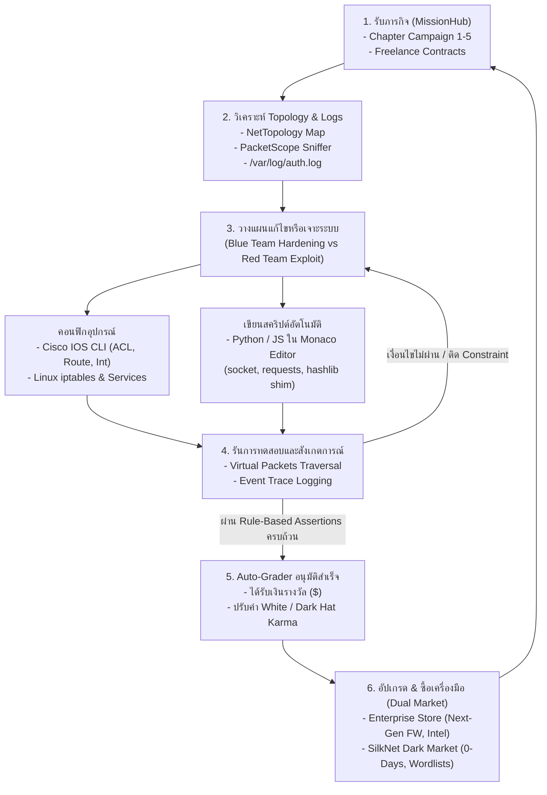

# Game Design Document (GDD) & System Architecture (v2.0 - Production Architecture Grade)
## โครงการ: **NetSec: Zero-Day Protocol**
**แนวเกม:** Cyber OS Terminal Simulator / Realistic Network & Cybersecurity Sandbox  
**แพลตฟอร์ม:** Web Application (React + TypeScript + Tailwind CSS + Monaco Editor + Dexie.js IndexedDB)  
**ภาษาเขียนโค้ดในเกม:** Python (Pyodide Worker) & JavaScript (Worker) ผ่าน Co-located Virtual Socket Engine  

---

## 1. Executive Summary & Core Pillars

### 1.1 วิสัยทัศน์ของเกม (High Concept)
**NetSec: Zero-Day Protocol** คือเกมจำลองการทำงานของวิศวกรระบบเครือข่ายและผู้เชี่ยวชาญด้านความปลอดภัยไซเบอร์ ในรูปแบบ **Virtual Cyber OS** ผู้เล่นจะได้ใช้งานหน้าต่างเดสก์ท็อปจำลอง, เขียนโค้ดอัตโนมัติด้วย Monaco Editor (VS Code), คอนฟิกเราเตอร์และสวิตช์ผ่านคำสั่ง **Cisco IOS CLI** จริง (รองรับ Standard/Extended ACL, Wildcard Mask, Routing), คอนฟิกเซิร์ฟเวอร์ Linux, ตรวจสอบ Log, เขียนสคริปต์ **Python และ JavaScript** เจาะและป้องกันระบบด้วย Library มาตรฐาน 1:1, รับมือภารกิจ 5 Chapters และ Freelance Bounties ควบคู่กับตลาดสองขั้ว Enterprise vs Dark Web

### 1.2 เสาหลักของเกม (Core Pillars)
1. **Industry-Grade Hands-on Experience:** เลียนแบบพฤติกรรมจริงของ Cisco IOS (User Exec, Privileged, Config, Interface, Access-List with Wildcard Mask & Implicit Deny) และ Linux Bash ตามมาตรฐานจริง
2. **Deterministic Simulation Core:** แยกระบบจำลองเครือข่ายออกจาก React UI ทำงานด้วย Virtual Clock (Ticks) และ Seeded PRNG ให้ผลลัพธ์ซ้ำเดิมทุกครั้งสำหรับการประเมิน Auto-grader
3. **Co-located Worker Sandbox (Sync-over-Direct Bridge):** แก้ปัญหา Pyodide synchronous I/O โดยการรัน Simulation Core ร่วมใน Sandbox Worker ทำให้คำสั่ง `socket.connect()` และ `send()` ทำงานแบบ Synchronous ตรงเข้า Engine ได้ทันทีโดยไม่ต้องรอ postMessage ข้าม Thread
4. **Multi-Layer Attack Surface Reduction (Defense-in-Depth):** ลดพื้นผิวการโจมตี (Attack Surface Reduction) จำกัดการเข้าถึง API ภายนอก, ป้องกันการยิงเน็ตเวิร์กจริงจาก Worker, มี Watchdog ควบคุมเวลา/หน่วยความจำ ป้องกัน `while True` ค้าง, และระบบ Auto-grader ตรวจสอบจาก Simulation Event Trace จริง ไม่ใช่การเช็ค stdout ปลอม (ยอมรับ Known Gaps ใน v1 สำหรับโหมด Single-Player ในเครื่องตัวเอง)

### 1.3 Threat Model & Out of Scope (v1)

#### 1.3.1 ขอบเขตความปลอดภัยของ v1 (Single-Player Local Sandbox)
- **Trust Boundary:** ผู้เล่นรันเกมบนเครื่องของตนเอง (Client-side Execution) ภายในเบราว์เซอร์ โค้ด Python/JS ของผู้เล่นทำงานอยู่ใน Web Worker ประจำแท็บของผู้เล่นเอง
- **In Scope (สิ่งที่มีการป้องกันใน v1):**
  - บล็อกการเชื่อมต่อไปยังเน็ตเวิร์กจริงภายนอก (Worker Scope Lockdown ปลด `fetch`, `XMLHttpRequest`, `WebSocket`, `importScripts`, `sendBeacon` ให้เป็น `undefined`)
  - ควบคุมการทำงานของโค้ดไม่ให้บล็อกเบราว์เซอร์หรือทรัพยากรเครื่อง (Watchdog Timer สั่ง terminate Worker เมื่อเกิด Infinite Loop หรือค้าง พร้อมกู้คืน State)
  - ป้องกันการหลอกผลตรวจของ Auto-Grader (ตรวจจาก Discrete Simulation Event Trace ภายใน Engine จริง ไม่เชื่อผลลัพธ์จากการ `print` stdout ลอย)
  - ลดพื้นผิวการโจมตี (Attack Surface Reduction) ปิดกั้นโมดูล FFI พื้นฐานและ Import Hook จากการเรียกทั่วไป
- **Out of Scope (สิ่งที่อยู่นอกเหนือขอบเขตความปลอดภัยของ v1):**
  - การรันโค้ดร่วมกันระหว่างผู้เล่นหลายคน (Untrusted Multi-Tenant / Multiplayer Execution)
  - ระบบแชร์สคริปต์ระหว่างผู้เล่น (Community Script Sharing) หรือภารกิจที่ดาวน์โหลดโค้ดภายนอกมาทำงาน
  - กระดานคะแนนแข่งขันระดับโลก (Competitive Global Leaderboards)
  - การปิดช่องโหว่ระดับ WASM/FFI สมบูรณ์ 100% (ยอมรับ 3 Known Gaps ที่ยังหลงเหลืออยู่ใน Pyodide สำหรับ v1)
  - การป้องกันไม่ให้เจ้าของเครื่องแก้ไข DOM หรือ Memory ในเบราว์เซอร์ของตัวเอง

#### 1.3.2 แผนรองรับโหมด Multiplayer / Leaderboards ในอนาคต (v2+)
หากเกมมีการเพิ่มระบบ Leaderboard, ภารกิจชุมชน, หรือการแข่งขัน ผู้เล่นจะต้องไม่รันสคริปต์ใน Realm เดียวกับ Simulation Core อีกต่อไป จะต้องแยก Realm โดยสิ้นเชิง (เช่น Sandboxed Iframe ต่าง Origin หรือ Cross-Origin Worker) และใช้การตรวจประเมินผลผ่าน Server-side Replay Verification แทน

## 2. Core Gameplay Loop



---

## 3. UI & Desktop Architecture (Virtual Cyber OS)

สถาปัตยกรรมหน้าจอถูกแยกออกจาก Simulation Core โดยเด็ดขาด โดย React และ Zustand จะทำหน้าที่เป็น **Presentation Layer** ที่รับเฉพาะ State Snapshot จาก Core ผ่าน Event Throttling:

```mermaid
flowchart LR
    subgraph Browser Main Thread [Presentation Layer]
        ReactUI["React Desktop UI<br/>(Window Manager)"]
        ZustandStore["Zustand View Store<br/>(UI Snapshots & Window States)"]
        ReactUI <--> ZustandStore
    end

    subgraph Simulation & Sandbox Worker [Deterministic Core]
        WorkerBridge["Worker Controller & RPC Bridge"]
        SimCore["Deterministic Simulation Core<br/>- Virtual Clock (Ticks)<br/>- L2/L3/L4 Network Graph<br/>- Cisco IOS & Linux Daemons<br/>- Event Trace Logger"]
        PyodideEngine["Pyodide Python Runtime<br/>+ Socket/Requests Shim"]
        JSEngine["JavaScript V8 Sandbox<br/>+ Virtual Net API"]

        PyodideEngine <-->|Direct Sync Calls| SimCore
        JSEngine <-->|Direct Sync/Async| SimCore
        SimCore --> WorkerBridge
    end

    WorkerBridge -->|Throttled Batched Events (60fps)| ZustandStore
    ZustandStore -->|Player Actions / CLI Commands| WorkerBridge
```

### 3.1 Core Applications
- **HyperTerminal:** รองรับ Multi-tab, เชื่อมต่อ Serial Console / SSH ไปยัง Switch, Router, หรือ Linux Server
- **CyberCode IDE:** Monaco Editor รองรับ Python/JS, มี Virtual File System Explorer, Linter, และปุ่ม Run พร้อม Watchdog Timer
- **NetTopology:** Interactive SVG/Canvas แผนผังเครือข่าย เม็ดพลังงาน Packet วิ่งตามสายตาม Virtual Ticks
- **PacketScope:** Wireshark-like GUI ดักจับ Frame/Packet ตรวจสอบ L2 MAC, L3 IP, L4 TCP/UDP/ICMP และ Hex Payload
- **MissionHub:** กระดานภารกิจแสดง Checkpoint ของ Auto-Grader พร้อม Constraint Status แบบเรียลไทม์
- **DualMarket:** ร้านค้าแยกฝั่ง Enterprise Tech vs SilkNet Dark Web พร้อมระบบบันทึก Karma
- **SysSettings:** จัดการธีม, ความเร็ว Virtual Clock (1x, 2x, 5x, Pause), และ IndexedDB Data Reset

---

## 4. In-Depth Simulation & Virtual Socket Architecture

### 4.1 การแก้ปัญหา Synchronous Socket ใน Pyodide (Co-located Worker Architecture)
เพื่อแก้ปัญหาที่ Python ใน Pyodide เป็น Synchronous และไม่สามารถรอ `postMessage` ข้าม Thread ได้ เราใช้สถาปัตยกรรม **Co-location: รัน `SimulationCore` อยู่ภายใน Worker เดียวกันกับ Pyodide**:

1. เมื่อผู้เล่นเขียน `import socket; s = socket.socket(); s.connect(("192.168.1.10", 80))`
2. ตัว Python Shim จะเรียกฟังก์ชัน JavaScript Bridge ที่ถูก expose ไว้ภายใน Worker execution scope เดียวกัน
3. การเรียกข้ามภาษาผ่าน `JsProxy` ภายใน Worker เดียวกันเป็น **Direct Synchronous Function Call** ที่ใช้เวลาหลัก Microsecond
4. `SimulationCore` ทำการตรวจสอบ Routing Table, Firewall ACL และ Listening Daemon ภายใน Tick ปัจจุบัน
5. คืนค่าผลลัพธ์กลับสู่ Python ทันที:
   - หากพอร์ตเปิด: คืน `None` สำหรับ `connect()` และ `0` สำหรับ `connect_ex()`
   - หากพอร์ตปิด (TCP RST): คืน `111` สำหรับ `connect_ex()` หรือโยน `ConnectionRefusedError`
   - หากพอร์ตถูกกรอง/ดรอป (Silent Drop): คืน `110` สำหรับ `connect_ex()` หรือโยน `socket.timeout`
   - หากไม่มีเส้นทาง: โยน `OSError(113, "No route to host")`

### 4.2 การลดพื้นผิวโจมตี (Attack Surface Reduction) และโครงสร้าง Python Socket Shim
โค้ด Bootstrap Shim ที่ inject ลงใน Pyodide มีฟังก์ชันครบถ้วนตามมาตรฐาน:
```python
# Injected Bootstrap in Co-located Pyodide Worker
import sys, types

class VirtualSocket:
    AF_INET = 2
    SOCK_STREAM = 1
    SOCK_DGRAM = 2
    SOL_SOCKET = 1
    SO_REUSEADDR = 2
    
    def __init__(self, family=AF_INET, type=SOCK_STREAM, proto=0):
        self.family = family
        self.type = type
        self.proto = proto
        self.timeout = None
        # Direct synchronous call to In-Worker Simulation Core
        self.fd = js_sim_core.createSocket(family, type)
        self.closed = False

    def __enter__(self):
        return self

    def __exit__(self, exc_type, exc_val, exc_tb):
        self.close()

    def settimeout(self, timeout):
        self.timeout = float(timeout) if timeout is not None else None
        js_sim_core.setSocketTimeout(self.fd, self.timeout)

    def connect(self, address):
        res = self.connect_ex(address)
        if res == 0:
            return None
        elif res == 110:
            raise TimeoutError("Connection timed out")
        elif res == 111:
            raise ConnectionRefusedError("Connection refused")
        elif res == 113:
            raise OSError(113, "No route to host")
        else:
            raise OSError(res, f"Socket error: {res}")

    def connect_ex(self, address):
        if self.closed: raise OSError(9, "Bad file descriptor")
        ip, port = str(address[0]), int(address[1])
        # Direct sync bridge
        res = js_sim_core.connectSocket(self.fd, ip, port, self.timeout)
        # res is a JS object: { success: bool, errno: number }
        return int(res.errno)

    def send(self, data):
        return self.sendall(data)

    def sendall(self, data):
        if self.closed: raise OSError(9, "Bad file descriptor")
        if isinstance(data, str): data = data.encode('utf-8')
        byte_list = list(data)
        sent = js_sim_core.sendSocket(self.fd, byte_list)
        return int(sent)

    def recv(self, bufsize):
        if self.closed: raise OSError(9, "Bad file descriptor")
        raw_bytes = js_sim_core.recvSocket(self.fd, int(bufsize))
        # Convert JS Uint8Array to Python bytes
        return bytes(raw_bytes.to_py())

    def bind(self, address):
        ip, port = str(address[0]), int(address[1])
        res = js_sim_core.bindSocket(self.fd, ip, port)
        if res.errno != 0: raise OSError(res.errno, "Bind failed")

    def listen(self, backlog=5):
        js_sim_core.listenSocket(self.fd, int(backlog))

    def accept(self):
        client_res = js_sim_core.acceptSocket(self.fd)
        if client_res.errno != 0: raise OSError(client_res.errno, "Accept failed")
        client_sock = VirtualSocket()
        client_sock.fd = client_res.clientFd
        return client_sock, (str(client_res.clientIp), int(client_res.clientPort))

    def setsockopt(self, level, optname, value):
        pass # Stubbed safely

    def close(self):
        if not self.closed:
            self.closed = True
            js_sim_core.closeSocket(self.fd)

# Build socket module
sock_mod = types.ModuleType("socket")
sock_mod.socket = VirtualSocket
sock_mod.AF_INET = VirtualSocket.AF_INET
sock_mod.SOCK_STREAM = VirtualSocket.SOCK_STREAM
sock_mod.SOCK_DGRAM = VirtualSocket.SOCK_DGRAM
sock_mod.SOL_SOCKET = VirtualSocket.SOL_SOCKET
sock_mod.SO_REUSEADDR = VirtualSocket.SO_REUSEADDR
sock_mod.timeout = TimeoutError
sock_mod.error = OSError
sock_mod.gethostbyname = lambda host: js_sim_core.resolveDns(host)
sock_mod.getaddrinfo = lambda host, port, *args: [(VirtualSocket.AF_INET, VirtualSocket.SOCK_STREAM, 0, '', (js_sim_core.resolveDns(host), port))]
sys.modules['socket'] = sock_mod
```

### 4.3 Virtual Requests Shim (บล็อกการยิงเน็ตจริง 100%)
สำหรับ `requests` ตัวเกมจะ inject shim ครอบทับ เพื่อแปลงคำสั่ง `requests.get()` และ `requests.post()` ให้สร้าง HTTP Packet เข้า Virtual HTTP Server ของ Simulator:
```python
class VirtualResponse:
    def __init__(self, status_code, text, headers):
        self.status_code = status_code
        self.text = text
        self.headers = headers
    def json(self):
        import json
        return json.loads(self.text)

class VirtualRequests:
    @staticmethod
    def get(url, timeout=5.0):
        res = js_sim_core.httpGet(url, timeout)
        return VirtualResponse(res.status, res.body, res.headers.to_py())

sys.modules['requests'] = VirtualRequests
```

### 4.4 Sandbox Attack Surface Reduction & Security Guardrails
1. **Sanitizing Global Scope ใน Pyodide:**
   - ลบ `sys.modules['js']` ทิ้งทันทีหลังรัน Bootstrap เสร็จสิ้น เพื่อป้องกันผู้เล่นเขียน `from js import fetch` หรือ `from js import globalThis`
   - ปิดกั้นโมดูล `urllib`, `http.client`, `pyodide.http`
2. **Watchdog & Resource Limiter:**
   - กำหนด **Instruction / Step Counter & Virtual Timeout** (ค่าเริ่มต้น 5.0 วินาที)
   - หากผู้เล่นเขียน infinite loop (`while True: pass`) ตัว Main Thread Watchdog จะส่งสัญญาณสั่ง `worker.terminate()` สร้าง Worker instance ใหม่พร้อมกู้คืน Simulator State ทันที โดยที่หน้าจอหลักไม่ค้าง

### 4.5 Cisco IOS Engine Specification
จำลองพฤติกรรมจริงของ Cisco IOS Router & Switch:
- **โหมดคำสั่ง:** User Exec (`>`), Privileged Exec (`#`), Global Config (`(config)#`), Interface Config (`(config-if)#`)
- **Access-Control Lists (ACL):**
  - **Standard ACL (1-99):** `access-list <id> {permit|deny} <source-ip> [wildcard-mask]`
  - **Extended ACL (100-199):** `access-list <id> {permit|deny} {tcp|udp|icmp|ip} <source> [wildcard] <dest> [wildcard] [eq <port>]`
  - **Implicit Deny:** ทุก ACL จะมีกฎ `deny ip any any` ปิดท้ายเสมอตามพฤติกรรมจริงของ Cisco IOS
  - **การผูก Interface:** `interface gig0/0` -> `ip access-group <id> {in|out}`
- **Routing Engine:**
  - `ip route <network> <netmask> <next-hop-ip>`
  - `show ip route` และ `show ip interface brief`

---

## 5. Declarative Auto-Grader & Assertion Engine

เพื่อป้องกันการโกง (เช่น การปลอมค่า stdout) และการตั้งค่าแบบทำลายระบบ (เช่น `deny ip any any`) ระบบประเมินผลจะใช้ **Event-Trace + State Verification + Constraint Enforcement**:

```typescript
export interface MissionStateSnapshot {
  simTicks: number;
  nodes: Record<string, NodeStateSnapshot>;
  packetEventLog: PacketEventTrace[];
}

export type MissionAssertion =
  | {
      type: 'PORT_STATE';
      sourceNodeId: string;
      targetIp: string;
      port: number;
      expectedState: 'OPEN' | 'FILTERED' | 'CLOSED';
      description: string;
    }
  | {
      type: 'NETWORK_REACHABLE';
      sourceNodeId: string;
      targetIp: string;
      expectSuccess: boolean;
      description: string;
    }
  | {
      type: 'CISCO_INTERFACE_CONFIG';
      nodeId: string;
      interfaceName: string;
      expectedIp: string;
      expectedSubnet: string;
      expectedStatus: 'UP' | 'DOWN';
      description: string;
    }
  | {
      type: 'ROUTE_TABLE_ENTRY';
      nodeId: string;
      destinationNetwork: string;
      expectedNextHop: string;
      description: string;
    }
  | {
      type: 'PACKET_TRACE_VERIFIED';
      sourceIp: string;
      targetIp: string;
      protocol: 'TCP' | 'UDP' | 'ICMP';
      minCount: number;
      description: string; // ตรวจว่ามี Packet วิ่งใน Simulator จริง
    }
  | {
      type: 'SERVICE_VULNERABILITY_PATCHED';
      nodeId: string;
      serviceName: string;
      isSecure: boolean;
      description: string;
    }
  | {
      type: 'LOG_RECORD_EXISTS';
      nodeId: string;
      logPath: string;
      regexPattern: string;
      description: string;
    };

export interface MissionConstraint {
  id: string;
  type: 'MAINTAIN_CONNECTIVITY';
  sourceNodeId: string;
  targetNodeId: string;
  description: string; // เช่น "ห้ามทำให้การเชื่อมต่อระหว่าง PC-A กับ Server ภายในขาดหาย"
}

export interface MissionDefinition {
  id: string;
  chapter: number;
  title: string;
  briefing: string;
  rewardMoney: number;
  rewardKarma: { white: number; dark: number };
  initialTopologyId: string;
  assertions: MissionAssertion[];
  constraints: MissionConstraint[];
}
```

---

## 6. Story Campaign & Red/Blue Progression Plan

### 6.1 Multi-Chapter Story Structure (ครบทั้ง 5 บท)
- **Chapter 1: The Local Loop (Blue Team - Network Fundamentals)**
  - คอนฟิก Cisco Router Interface (`gig0/0`, `gig0/1`), Subnetting `/24` และ `/28`, Static Route, และทดสอบ Ping ระหว่าง VLAN
- **Chapter 2: The Perimeter Shield (Blue Team - Hardening & ACL)**
  - เขียน Extended ACL (100) กรองเฉพาะพอร์ต 80/443, บล็อก SSH จากภายนอก แต่ห้ามบล็อก LAN ภายใน (Constraint), ตรวจสอบ Syslog
- **Chapter 3: Shadow Recon (Red Team - Port Scanning & Discovery)**
  - เขียนสคริปต์ Python ใช้ `socket` ตรวจหาเปิด-ปิดพอร์ตของบริษัทคู่สัญญา, ดักจับ Banner Grabbing ระบุเวอร์ชัน Nginx/FTP
- **Chapter 4: Lateral Pivot & Tunneling (Red Team - Pivoting)**
  - เจาะเครื่อง DMZ Web Server ผ่านช่องโหว่ Credential, ตั้งค่า SSH Local Port Forwarding เพื่อเปิดทางเชื่อมต่อไปยัง Internal Database Subnet ที่ไม่มี Public IP
- **Chapter 5: Incident Zero: The Breach Protocol (Dual Role Climax)**
  - การโจมตีแบบ Worm แบบเรียลไทม์ ผู้เล่นต้องเขียนสคริปต์วิเคราะห์ `/var/log/auth.log` ดึง IP ผู้โจมตี นำไปอัปเดต ACL บน Cisco Router อัตโนมัติ พร้อมกู้คืนเซิร์ฟเวอร์ที่ถูกบุกรุก

---

## 7. Dual Market & Game Economy Balance

### 7.1 ตารางสมดุลเศรษฐกิจ (Economy Calibration)
| รายการ | ประเภท | เงื่อนไข Karma | ราคา ($) | ผลลัพธ์ในเกม |
|---|---|---|---|---|
| **CPU Upgrade (Dual-Core Virtual)** | Hardware | ไม่จำกัด | $500 | เพิ่มความเร็ว Worker Execution 2 เท่า |
| **RAM Expansion (Virtual Buffers)** | Hardware | ไม่จำกัด | $800 | รองรับการเปิด Terminal 6 แท็บพร้อมกัน |
| **Enterprise Threat Intel Feed** | Software | White Karma >= 50 | $1,200 | ไฮไลต์ Packet ที่น่าสงสัยบน Topology เป็นสีส้ม |
| **Cisco Advanced Router License** | Hardware | White Karma >= 100 | $2,500 | ปลดล็อกคำสั่ง NAT, Dynamic Routing (RIP/OSPF) |
| **DarkNet Wordlist "RockYou-Mini"** | Tool | Dark Karma >= 30 | $600 | เพิ่มความเร็วในการแคร็กรหัสผ่านใน Chapter 3-4 |
| **Zero-Day Exploit Script (CVE-Mock)** | Exploit | Dark Karma >= 100 | $3,000 | สคริปต์เจาะระบบ Bypass Firewall บางพอร์ต |

---

## 8. Persistence Architecture (Dexie.js IndexedDB)

ใช้ **IndexedDB ผ่าน Dexie.js** แทน LocalStorage เพื่อรองรับขนาดข้อมูล Simulator Snapshot ขนาดใหญ่ และมี **Schema Versioning & Migrations**:
```typescript
import Dexie, { Table } from 'dexie';

export interface SaveGameRecord {
  id: string;
  version: number;
  playerName: string;
  money: number;
  karma: { white: number; dark: number };
  inventory: string[];
  activeChapter: number;
  completedMissions: string[];
  topologySnapshot: any;
  vfsSnapshot: any;
  updatedAt: number;
}

export class NetSecDatabase extends Dexie {
  saves!: Table<SaveGameRecord, string>;

  constructor() {
    super('NetSecDB');
    this.version(1).stores({
      saves: 'id, version, updatedAt, activeChapter'
    });
  }
}
```

---

## 9. Revised Roadmap (เริ่มด้วย Phase 0 Vertical Spike)

| เฟส | ขอบเขตงาน (Milestones) | เกณฑ์การผ่าน (Acceptance Criteria) |
|---|---|---|
| **Phase 0: Proof-of-Concept Vertical Spike** | - สร้าง Minimal Co-located Worker (Pyodide + Mini Simulator Core)<br/>- ทดสอบรัน Python `socket.connect()` แบบ Synchronous ผ่าน Virtual Bridge<br/>- ทดสอบการคืนค่า ConnectionRefused และ Timeout | Python รัน `s.connect(('192.168.1.1', 80))` ใน Worker แล้วได้ผลตอบรับแบบ Synchronous ทันทีโดยไม่ค้าง |
| **Phase 1: Project Scaffolding & Virtual Cyber OS** | - ติดตั้ง React + Vite + TypeScript + Tailwind CSS + Dexie.js<br/>- พัฒนา Window Manager (Zustand, Drag, Resize, Z-index, Taskbar)<br/>- Theme Switcher (Cyber Neon, Matrix Green, Dark Modern, Clean Light)<br/>- เตรียม IndexedDB Save Schema | หน้าต่างจำลองเปิด-ปิด ย่อ-ขยาย และสลับธีมได้อย่างลื่นไหล |
| **Phase 2: Core Network Simulator & Unified Engine** | - พัฒนา In-memory Layer 3/4 Engine (IP, Subnet, Routing Table, ARP)<br/>- พัฒนา Cisco IOS CLI Parser (enable, conf t, int, ip addr, ip route, standard/extended ACL with wildcard & implicit deny)<br/>- พัฒนา Linux Bash Shell พื้นฐาน (ping, traceroute, ifconfig, cat, syslog)<br/>- พัฒนา Declarative Assertion Engine + Constraint Checker | พิมพ์คำสั่ง Cisco และ Linux ใน Terminal จำลองได้สมจริง และทดสอบ Ping/ACL ผ่าน Engine กลาง |
| **Phase 3: CyberCode IDE & Scripting Sandbox Integration** | - นำ Pyodide Co-located Worker จาก Phase 0 มาเชื่อมต่อกับ Monaco Editor<br/>- พัฒนา Watchdog Timer สั่ง terminate Worker เมื่อเกิด Infinite Loop<br/>- พัฒนา JavaScript Worker Sandbox ด้วย Virtual API เดียวกัน<br/>- เพิ่ม Requests Shim และ Hashlib Support | สามารถเปิดหน้าต่าง IDE เขียน Python/JS สแกนพอร์ตเป้าหมาย และดูผลบน Simulator ได้ |
| **Phase 4: NetTopology & PacketScope Visualizers** | - พัฒนา Interactive Topology Canvas แสดงอุปกรณ์และสายเคเบิล<br/>- รับ Throttled Event Batch แสดงเม็ดพลังงาน Packet วิ่งตามสาย<br/>- พัฒนาแอพ PacketScope (Wireshark จำลอง) แสดง L2/L3/L4 Header | เห็นการเดินทางของ Packet และสามารถคลิกดักดูข้อมูลใน PacketScope ได้ |
| **Phase 5: Campaign Chapter 1-2 & Freelance Bounties** | - บรรจุโจทย์ Chapter 1: The Local Loop & Chapter 2: The Perimeter Shield<br/>- ระบบภารกิจ MissionHub พร้อม Auto-grader ประเมินผลตาม Assertion & Constraint | ผู้เล่นสามารถเล่นจบ Chapter 1 และ 2 รับเงินรางวัลและปรับค่า Karma ได้สมบูรณ์ |
| **Phase 6: Red Team Mechanics, Chapter 3-5 & Polish** | - เพิ่มระบบ Banner Grabbing, Pivoting, Log Incident Response สำหรับ Chapter 3-5<br/>- พัฒนาระบบร้านค้า Dual Market (Enterprise vs SilkNet)<br/>- ใส่ระบบเสียง (Web Audio API) และขัดเกลาเกมเพลย์พร้อมเล่น | เกมสมบูรณ์ระดับ Release Playable Candidate |
